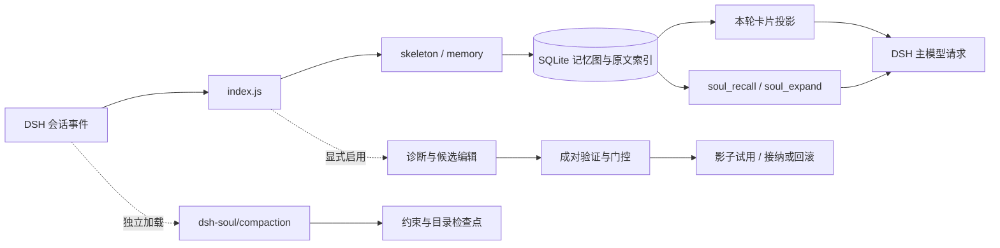

# DSH Soul 2.1.0 — 图记忆修复与可选动力学重做

为 DSH 保存会话中的约束、决策、产物与进度，用本地记忆图和原文索引找回细节，并提供独立的图压缩后端与受控演化流程。

记忆默认开启，记忆动力学与演化默认关闭。抽取和检索在本地执行，不修改模型权重；投影进入主模型上下文仍有 token 成本。演化中的候选编辑与探测会使用显式配置的模型路由。

## 2.1 相比 2.0 改了什么

- **减少误作废。** 去掉「决定、改成、必须」等指令词后，按对象实体判断是否为同一件事；不同实例不会仅因句式相似互相作废。
- **对齐宿主坐标。** 节点保存会话与事件 `seq`；压缩加权改按实体匹配，目录无法对齐时明确标注不可直接用于 `soul_expand`。
- **修正召回排序。** 按联想强度和扩散可达度排列邻居；同次回捞命中的有效节点可以建立关联，被取代或被纠正的节点不参与关联扩散。
- **退役记录仍可回捞。** 不再按 30 天固定删除；总行数超过容量上限四倍时才清理最旧的非活动记录。恢复操作不会复活已经作废的约束。
- **校验已记录的产物。** 检查文件内容指纹，外部修改后标记过时；后续重写同一文件时取代旧产物节点。真实工具参数解析仍有已知缺口，见下文。
- **减少自我污染。** 卡片的 `runtime-context` 快照不再重新编译进记忆图或原文索引；普通报错不再被误判为用户纠正。
- **重做可选动力学。** 统一使用历史、工作记忆、当前线索、图上下文与纠正惩罚，按「本轮可能需要」排序；支持侧抑制、时间边与学习边整理。`memory.dynamics` 仍默认关闭。
- **新增回放评估。** 支持合成负载与 JSONL 回放、工具路径评分和线索消融；真实日志适配限制见「验证与已知问题」。数据库升级为 Schema 9。

完整说明见 [2.1 发布说明](RELEASE-2.1.md) 和 [CHANGELOG](CHANGELOG.md)。

## 安装与升级

需要 Node.js 24+，DSH 支持范围为 `>=0.2.1-rc.2 <0.3.0-0`。0.2.0-rc.2 不在支持范围。CI 验证 rc.2 的接入与旧版拒绝路径，本机另验证了桌面端 0.2.1-rc.5。

从本仓库 [v2.1.0 Release](https://github.com/icyaaaww/dsh-soul/releases/tag/v2.1.0) 下载插件安装包与 `SHA256SUMS.txt`：

```powershell
dsh plugin --profile tui add "https://github.com/icyaaaww/dsh-soul/releases/download/v2.1.0/dsh-soul-2.1.0.tgz"
```

`tui` 替换为实际 profile。请使用本仓库的 Release 安装包；npm 上的裸名 `dsh-soul` 可能指向另一位作者的项目。

升级前停止使用该数据库的插件实例，并备份对应 profile 的 `evolve.sqlite` 及相关 WAL 文件。该插件的旧版数据库会自动迁移到 Schema 9；旧插件不能打开更高版本数据库，降级需恢复升级前备份。不要让不同插件版本同时写入同一数据库。

## 配置：先只开记忆

```yaml
- id: dsh-soul
  config:
    profile: tui
    memory:
      enabled: true
      dynamics: false
      projectionBytes: 600
    evolution:
      enabled: false
```

纯记忆模式依赖宿主 `tools`、`systemPrompt`、`commands`，不必单独为 Soul 配置 `provider/model`。DSH 主模型仍由宿主管理。

| 配置 | 默认 | 作用 |
| --- | --- | --- |
| `memory.enabled` | `true` | 本地记忆、投影与回捞 |
| `memory.projectionBytes` | `600` | 投影字节预算，不是 token 数 |
| `memory.maxNodes` | `500` | 自动剪枝与合并使用的容量上限 |
| `memory.verifyArtifacts` | `true` | 校验已抽取产物的文件内容指纹 |
| `memory.dynamics` | `false` | 使用历史、线索与图关联参与卡片排序 |
| `memory.promote` | `false` | 为未抽取成节点的环境事实补充引用节点 |
| `memory.maintenance` | `true` | 合并重复节点、整理学习边 |
| `memory.maintenanceTurns` | `20` | 两次常规整理至少间隔的轮数 |
| `evolution.enabled` | `false` | 显式启用受控演化 |

旧顶层 `enabled` 是**演化**开关别名，显式 `evolution.enabled` 优先。旧 `enabled: false` 不会关闭默认记忆；完全停用需同时关闭记忆与演化。`injectHarness: false` 只控制演化组件注入，不关闭记忆投影。

数据库默认位于 `DSH_HOME/dsh-soul/<profile>/evolve.sqlite`；未配置 `DSH_HOME` 时使用 `~/.dsh`。不同 profile 不共享默认库，记忆另按项目作用域区分。无法确定 profile 且未指定 `database` 时会明确报错。

## 项目结构与工作流

```text
dsh-soul/
├─ index.js                  主插件入口：事件、工具、命令和提示上下文
├─ compaction.js             独立图压缩入口
├─ src/
│  ├─ skeleton.js            事件规范化、结构抽取与骨架选择
│  ├─ memory.js              记忆捕获、纠正、投影、回捞与学习关联
│  ├─ graph-memory.js        图读取、可选动力学、排序与解释
│  ├─ store.js               SQLite、Schema 迁移与证据账本
│  ├─ span-index.js          原文片段索引与全文检索
│  ├─ session-search.js      会话搜索与按事件范围展开
│  ├─ compaction.js          图压缩实现，复用宿主框架
│  ├─ directory.js           可寻址的会话目录
│  ├─ evolve.js              受控演化编排
│  ├─ probe.js / validation.js 成对探测与结果验证
│  └─ gate.js / watch.js     门控、影子试用与回滚
├─ harness/default/          C1–C5 默认框架指引
├─ tests/                    单元、回归与宿主集成用例
├─ bench/                    压缩、回放与兼容性基准
└─ docs/                     设计与验证说明
```



### 一轮任务怎样变成记忆

1. 入口收集用户消息、工具调用与结果，保留宿主 session 与事件 `seq`。
2. 每轮结束后，规范化与规则抽取生成约束、决策、产物和进度节点，写入本地 SQLite。
3. `derived`、`supersedes`、`related`、`coactivated`、`precedes`、`contradicts` 等边记录来源、替换、关联与纠正。原文片段另行索引。
4. 下一轮选择预算内的信息作为提示上下文。投影来自持久化的记忆图；宿主可能将它记录为运行时快照，Soul 会排除这些快照，避免再次入图。
5. 需要细节时，`soul_recall` 查询记忆和原文，`soul_expand` 按事件坐标展开。退役、取代与纠正状态会影响当前选择，原文与索引仍受保留上限约束。

```text
/mem show                    查看当前记忆卡片
/mem stats                   查看节点、边与索引统计
/mem recall <关键词>         回捞节点与原文
/mem graph <关键词或 id>     查看节点与邻居
/mem dynamics                查看 need / score 等排序解释
/mem sleep                   合并重复、整理学习边；启用动力学时可退役弱节点
/mem restore <id>            恢复符合条件的退役节点
/mem prune                   按配置容量清理
```

### 可选记忆动力学

默认卡片按置顶、类型与新旧排序。开启 `memory.dynamics` 后，使用历史、工作记忆、当前任务线索、图上下文、意外度与纠正惩罚共同影响排序：

```text
need = 基础激活 + 工作记忆 + 当前线索 + 图上下文 + 意外度 − 纠正惩罚
score = need + ln(importance)
```

激活来自用户提及、工具读写、回复引用与回捞等使用证据，不来自展示。侧抑制避免同一对象重复占满卡片；动力学模式下置顶约束最多占 60% 预算。学习边可以衰减与缩放，结构和相似度边不随空闲整理衰减。

动力学改变卡片内容，可能增加运行时快照变动与上下文成本，因此保持默认关闭。`/mem dynamics` 可查看排序依据；它不是模型权重训练或生物神经元仿真。

## 独立图压缩后端

普通插件安装**不会自动替换**宿主压缩器。需要使用图压缩时，在实际 profile 中将原后端替换为：

```yaml
# 移除原来的 @deepseek-ai/dsh-compaction-basic 配置后，再加载：
- name: dsh-soul/compaction
```

一个 context 只能挂载一个压缩服务。该入口在挂载时解析宿主的 `@deepseek-ai/dsh-compaction-basic`，继承 `BasicCompactionEngine`，只覆盖 `summarize()`；重放、持久锁、表层替换和 checkpoint 提交继续由宿主负责。

默认输出约束与可寻址目录，短跨度可回退为骨架选择。目录与宿主坐标对不上时会明确标注不可直接展开。压缩本身返回 `llmStreamCall: false`，不额外调用模型；预算按跨度的 20% 计算，限制在 600–3000 字节，并受 45% 跨度上限约束。跨度不足 1200 字节时明确拒绝，避免检查点固定开销令结果变大。

后端可以在没有记忆库时从跨度重建结构；记忆库可用时，图加权按实体而非不相交的序号匹配。正文回捞仍依赖实际保留的会话与索引，不能承诺无限保留。

## 受控演化：默认关闭

演化需要 Git、宿主可用的模型路由与对应 skills/spawn 执行能力。显式配置后，通过 `/evolve run` 启动：

```yaml
- id: dsh-soul
  config:
    profile: tui
    memory:
      enabled: true
    evolution:
      enabled: true
    provider: your-provider
    model: your-model
    validationTrials: 2
    checks:
      - name: project-tests
        argv: [node, --test, tests/acceptance.test.mjs]
        protectedPaths: [tests, package.json]
```

流程为：记录偏差 → 定位一个组件 → 候选编辑 → 结构检查 → 同一固定提交上的基准/候选成对回放 → 项目验收 → 门控 → 影子试用 → 接纳或回滚。

验收命令必须检查真实产物。文件型检查应声明 `protectedPaths`，覆盖验收逻辑与配置；不支持 glob。探测在独立 Git worktree 执行，被忽略的依赖与环境不会自动复制。提示变短、调用变少或用户没有继续纠正，都不能单独作为采纳证据。

```text
/evolve status               能力、规则、预算与试用状态
/evolve diagnose             分歧、重复模式与候选目标
/evolve run [C1–C8]          显式启动精炼
/evolve verify               验收最近一次真实试用任务
/evolve report               经验与演化结果
/evolve diff [A] [B]         比较版本
/evolve rollback [rev]       回滚
/evolve log [n]              查看审计账本
```

## 八个组件如何生效

| 组件 | 存储形式 | 实际连接 |
| --- | --- | --- |
| C1 工作方式 | system.md | 主会话与探测子会话的提示上下文，保留锚定区 |
| C2 护栏 | guardrails.md | 同上；不能改宿主权限和审批规则 |
| C3 项目事实与记忆策略 | memory.md | 同上；不是旧 Soul 记忆检索系统 |
| C4 工具指引 | tools.md | 同上 |
| C5 委派指引 | subagents.md | evolve_catalog 返回决策指引；evolve_delegate 启动真实 spawn 并给子代理加载指引 |
| C6 技能 | skills/<name>/SKILL.md | 注册到真实 ctx.skills provider，宿主 skill 工具按需读取 |
| C7 脚本 | scripts/<name>.mjs | evolve_script 在可终止独立进程中执行纯 JSON 转换 |
| C8 工具反馈 hook | hooks/<name>.mjs | 真实 tools/post-execute 事件调用，追加建议，保留原始值和错误状态 |

候选探测与线上使用同一套组件加载机制。候选目录拥有独立的技能视图；探测结束移除视图。版本切换会使技能目录缓存失效，脚本和 hook 根据当前版本重新选择；回滚后不能再加载被撤销的组件。已进入历史上下文的文字不会被擦除。

### C5：委派

先调用 evolve_catalog 读取 delegationPolicy，再调用 evolve_delegate，并写清子任务与验收标准。子代理遵守宿主递归深度和权限；不修改 provider 配置，不扩大授权。探测中的插件委派以及可识别的本地宿主后代调用，共用该探测的请求上限和预算，usage 汇总进对照指标。远程或外部工具自行调用第三方服务不在此计量范围。

### C6：技能

~~~markdown
---
name: build-check
description: 构建失败时使用，先检查依赖，再执行项目验收
---
先检查项目声明的构建命令与依赖，再执行相关验收，报告通过和失败项。
~~~

对应路径 skills/build-check/SKILL.md，宿主注册名为 soul-build-check。元数据仅支持 name 和单行 description。技能正文按需加载；宿主仍会展示简短技能目录，这部分也会占用上下文。

### C7：脚本

~~~javascript
export function run(input) {
  return [...new Set(input)].sort()
}
~~~

用 evolve_script 传入 name 和 JSON 字符串 input。当前契约是独立纯函数：不提供 import、文件、网络、进程、环境变量或宿主工具接口。输入最多 100 KB（含代码），输出最多 24 KB，进程超时 5 秒，单次同步执行最多 200 毫秒。需要读写项目文件时仍调用宿主工具，保留其权限链。

### C8：hook

~~~javascript
export const timeoutMs = 100
export const failOpen = true
export function run(event) {
  return event.isError ? {note: '先检查失败原因，避免原样重复调用。'} : {}
}
~~~

当前只连接工具执行后的建议反馈；不替换工具参数、结果、成功状态或审批结果。运行失败、超时、非法输出不会拦截原工具结果。每个 hook 的 timeoutMs 为 1–1000 毫秒，总进程生命周期上限 1 秒，最多激活 4 个；单次同步执行最多 200 毫秒。hook 运行在独立进程中，代码无法通过提供的接口直接调用宿主服务。


## 验证与已知问题

### 测试覆盖

- 本机 Windows / Node 24.19.0 / 桌面端 DSH 0.2.1-rc.5：完整测试 **225 通过，0 失败，0 跳过**。
- GitHub CI 覆盖 Windows、Ubuntu 的常规检查，以及 DSH 0.2.1-rc.2 的宿主接入；0.2.0-rc.2 用于验证不支持旧宿主时的拒绝路径。
- 宿主用例使用真实 Cordis、AgentLoop、SessionStore、ToolRuntime 等服务，模型响应使用确定性适配器，不能据此推算真实模型任务成功率。

### 尚未修复的真实端适配缺口

- `src/skeleton.js` 的工具参数解析接受对象，却尚未解码 JSON 字符串形式的 `arguments`。标准文件工具可能执行成功但没有产物记忆节点；这也影响依赖工具路径的指纹与使用激活。已有产物逻辑修复不等于所有宿主工具格式都已覆盖。
- `bench/replay.mjs` 的工具路径评分仅读取 `input.path`，尚未适配上述字符串参数与 `file_path`。真实日志可能得到零评分样本；分母为零时显示的 `0.0%` 不能作为召回率结论。
- 进程级数据库共享缓存的多实例/热重载隔离仍有既有风险。不要让同一进程中的多个实例交替指向不同数据库。

这些问题在本次 2.1.0 包中尚未修复，不能把现有测试全绿解释为真实端全面验收通过。

### 基准如何解读

合成压缩基准 `npm run bench`：300 个场景、名义 1200 字节预算，窗口截断细节保留率 25.5%，规则摘要代理 43.2%，骨架选择 83.4%。**规则摘要代理不是原版 DSH 的真实模型摘要**；该基准的骨架策略也不等同于独立后端的默认目录模式。

`node bench/replay.mjs --truth=tools` 在合成 120 轮、600 字节卡片预算下得到：

| 策略 | 卡片命中率 | 卡片变动率 |
| --- | --- | --- |
| `recency` | 46.7% | 30.3% |
| `due` | 15.0% | 4.2% |
| `need-cue`（关闭当前线索） | 53.9% | 100.0% |
| `need` | 80.4% | 99.2% |

它比较的是插件内部策略，不是「有插件/无插件」的真实任务提升。`--fit` 只表示在当前负载拟合参数；真实 JSONL 回放还受上述适配缺口限制。

## 开发与复现

```powershell
npm run check
npm run demo
npm run bench
node bench/replay.mjs --truth=tools

# 显式使用已安装的真实宿主依赖：
$env:DSH_TEST_PACKAGE = 'C:/runtime/node_modules/@deepseek-ai/dsh/package.json'
# 将上行替换为实际安装的 DSH package.json 路径。
npm run test:host
```

测试缺少宿主路径时，相应集成用例会跳过；`test:host` 则要求明确设置路径。测试源码位于 `tests/`，机制基准位于 `bench/`，历史设计和验证记录位于 `docs/`。历史文档中的结果对应各自版本，不代表当前版本已经完成同等实机质量评估。
